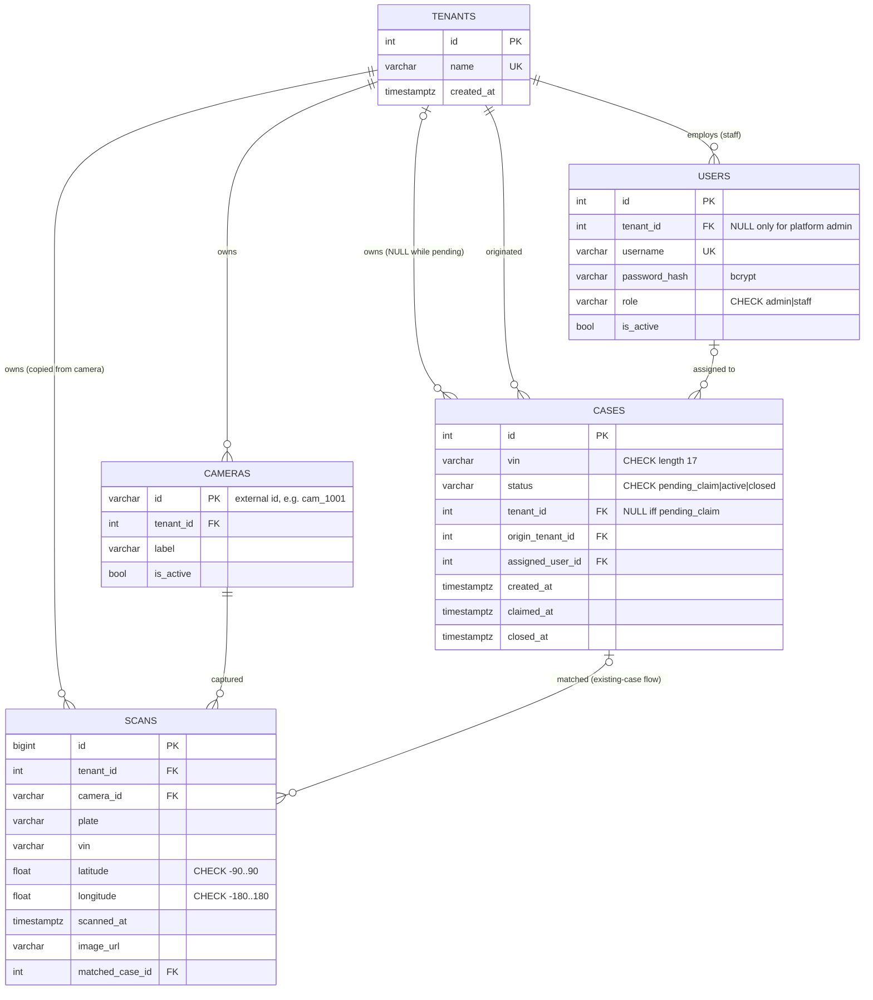
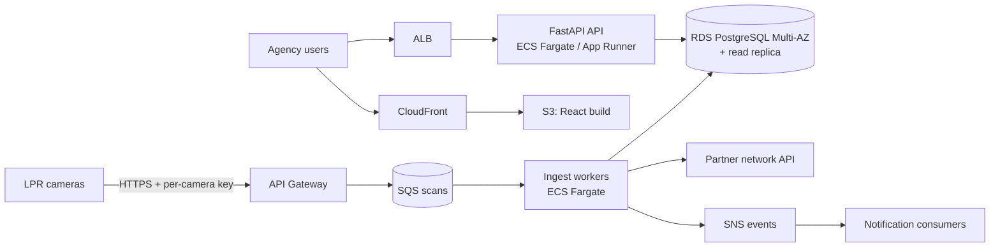

# Design note: Plate Scan & Case Matching Service

## 1. Database schema



### Constraints and indexes

The database enforces the core rules itself, so they hold even if application code has a bug:
- **`uq_cases_open_vin`** is a partial unique index on `cases(vin)` covering only rows where `status IN ('pending_claim','active')`. It allows at most one open case per VIN across all tenants, while closed cases can repeat.
- **`ck_cases_owner_matches_status`:** a pending case has no owner, and an active or closed case always has exactly one.
- **`ck_users_role_matches_tenant`:** `staff` users belong to exactly one tenant, and the platform `admin` belongs to none.
- **Range checks** on latitude and longitude, and a length check on VINs.
- **Indexes for the read paths:**
  - `scans(vin, scanned_at)` for the location trail
  - `scans(tenant_id, scanned_at)`
  - `cases(tenant_id, status)` for "my cases"
  - `cases(status, created_at)` for the claimable list

## 2. Multi-tenancy and access control

- **The tenant never comes from the client.**
  - **Scan ingest** has no login, so the tenant comes from the registered camera. `scans.tenant_id` is copied from `cameras.tenant_id` when the scan is written. An unknown camera gets 404, an inactive one gets 403, and nothing is stored.
  - **Dashboard API:** `get_current_user` decodes the JWT, uses only `sub` (the user id), and loads the user from the database on every request. The token's `tenant_id`/`role` claims and any `tenant_id` in a request body are ignored. A forged or stale claim can't widen access, and deactivating a user takes effect immediately.
- **Scoping lives in one place.** Every case query goes through one of two predicates in `services/case_service.py`, so there's a single place to audit:
  - `_visible_to(user)` = `tenant_id = :me OR status = 'pending_claim'`, used for lists and detail
  - `_owned_by(user)` = `tenant_id = :me`, used for the trail
- **404, not 403.** A case outside your scope returns 404, exactly like one that doesn't exist, so case ids reveal nothing.
- **The `pending_claim` exception.** Pending cases are visible to every tenant and owned by none (`tenant_id IS NULL`). `origin_tenant_id` records whose camera found the case. Responses never reveal the originating tenant.
- **Atomic claim.** A claim is a single statement:

  ```sql
  UPDATE cases SET status='active', tenant_id=:me, assigned_user_id=:user, claimed_at=now()
  WHERE id=:id AND status='pending_claim' RETURNING *
  ```

  Postgres locks the row, so among concurrent claims exactly one wins and the others update zero rows. There's no read-then-write gap. A follow-up read decides the error:
  - **409** for the owner or the originating tenant, who already know the case exists
  - **404** for everyone else
- **One open case per VIN, even under races.** Two simultaneous scans of a new VIN can both pass the "no open case" check. The case insert therefore runs inside a SAVEPOINT. When `uq_cases_open_vin` rejects the losing insert, only that insert rolls back: its scan is kept, and that request reports `already_open_elsewhere`. A two-thread test reproduces this.
- **Trail redaction.** The owner's trail contains every scan of the VIN, ordered by time.
  - Own scans are returned in full.
  - Other tenants' scans use a separate response model containing only latitude, longitude, time, plate and VIN.

  Because it's a separate model, camera ids, image URLs and tenant identity can't leak even by mistake. Sighting *locations* help the case owner recover the vehicle, while each agency's camera fleet stays private.
- **Roles.**
  - **Staff** use the case endpoints.
  - **The platform admin** creates tenants, staff users and cameras, and gets 403 on every case endpoint, so platform operators never see agency data.

## 3. Ingest flow

1. Validate the payload and resolve the camera.
2. Insert the scan. It is always kept.
3. Look up the open case for the VIN:
   - **This tenant's active case:** link the scan to it (`existing_case`).
   - **Pending, or another tenant's active case:** don't open a duplicate (`already_open_elsewhere`).
4. If there's no open case, call the partner eligibility API with a timeout. Failure or timeout counts as not eligible.
   - **Eligible:** insert a `pending_claim` case inside the savepoint (`new_case_created`).
   - **Otherwise:** `not_eligible`.
5. Commit.

## 4. Notifications (design only, not implemented)

1. **Publish events after commit.** Write them to an outbox table in the same transaction, so events are never lost and never sent for rolled-back work:
   - `case.pending_created`, for all tenants
   - `scan.matched`, for the case owner
   - `case.claimed`, for the originating tenant
2. **Fan out.** A relay publishes the events to **SNS**, which fans out to **SQS** queues per channel:
   - **WebSocket** for live dashboard updates (API Gateway WebSocket)
   - **Mobile push** for agents in trucks
   - **SES email** digests
3. **Filter by tenant subscription.** Consumers deliver each tenant only its own events, plus network-wide pending-case events.

## 5. AWS deployment and scaling



- **API:** a stateless container on ECS Fargate (or App Runner) behind an ALB, with autoscaling on CPU and request count.
- **Frontend:** a static build on S3, served through CloudFront.
- **Database:**
  - RDS PostgreSQL, Multi-AZ, with automated backups and point-in-time recovery.
  - A read replica serves dashboard reads.
  - As `scans` grows, partition it by month on `scanned_at` and archive old partitions to S3.
- **High-volume ingest:** API Gateway → SQS → workers, with autoscaling on queue depth and a dead-letter queue. Cameras get a fast `202 Accepted`, bursts are absorbed, and a slow partner never blocks a camera. Add an idempotency key per scan.
- **Secrets:** the JWT key, database credentials and camera keys live in Secrets Manager, injected into ECS tasks. Each service gets a least-privilege IAM role.
- **Observability:**
  - CloudWatch logs (structured JSON)
  - Alarms on 5xx rate, p95 latency, queue age, DLQ depth, RDS CPU and connections, and the eligibility failure rate
  - X-Ray or OpenTelemetry tracing
- **CI/CD:**
  1. run the tests against a Postgres service container
  2. build the image and push it to ECR
  3. run Alembic migrations as a one-off task
  4. do a rolling or blue/green deploy

## 6. Known trade-offs

- **The eligibility call runs inside the ingest transaction**, for up to 3 s. That's fine at demo scale and is the main reason for the SQS worker design above.
- **Sharing sighting locations with case owners is a policy choice.** A real product would need tenant consent and contract terms.
- **Isolation is enforced in one application module plus database constraints.** Postgres row-level security would add a second layer.
